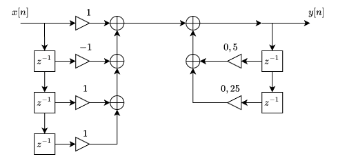

# Ejercicio 1

## Descripcion

El Ejercicio 1 es un **acumulador sincronico con seleccion de entrada**. En cada flanco ascendente del reloj suma al valor acumulado (`o_data`, de 6 bits) un valor que depende de la señal de seleccion `i_sel`:

| `i_sel` | Valor sumado        |
| ------- | ------------------- |
| `00`    | `i_data1`           |
| `01`    | `i_data1 + i_data2` |
| `10`    | `i_data2`           |
| `11`    | `0` (se mantiene)   |

La suma se realiza en 7 bits: los 6 bits inferiores se realimentan como nuevo valor acumulado y el bit mas significativo se registra como bandera de desborde en `o_overflow`. El circuito tiene un reset asincronico activo en bajo (`i_rst_n`) que pone ambas salidas en cero.

### Interfaz

| Señal        | Direccion | Ancho | Descripcion                                   |
| ------------ | --------- | ----- | --------------------------------------------- |
| `i_data1`    | Entrada   | 3     | Primer dato (sin signo)                       |
| `i_data2`    | Entrada   | 3     | Segundo dato (sin signo)                      |
| `i_sel`      | Entrada   | 2     | Seleccion del valor a acumular                |
| `clk`        | Entrada   | 1     | Reloj, activo por flanco ascendente           |
| `i_rst_n`    | Entrada   | 1     | Reset asincronico, activo en bajo             |
| `o_data`     | Salida    | 6     | Valor acumulado                               |
| `o_overflow` | Salida    | 1     | Indica que la ultima suma desbordo los 6 bits |

## Composicion

El camino de datos esta formado por cuatro modulos conectados en `top.v`:

```
i_data1 ─┬──────────────────────► in0 ┐
         │   ┌─────────────┐          │
         ├──►│ adder_4bits ├──────► in1 ├─ mux_3a1 ─► adder_7bits ─► latch ─┬─► o_data
i_data2 ─┼──►└─────────────┘          │     ▲              ▲                 └─► o_overflow
         └──────────────────────► in2 ┘     │              │                 │
                                          i_sel            └─────────────────┘
                                                             (realimentacion)
```

| Archivo         | Modulo        | Descripcion                                                                                                                                                           |
| --------------- | ------------- | --------------------------------------------------------------------------------------------------------------------------------------------------------------------- |
| `top.v`         | `top`         | Top level. Instancia y conecta los demas modulos, realimentando la salida del registro al sumador de 7 bits.                                                          |
| `adder_4bits.v` | `adder_4bits` | Sumador combinacional sin signo de dos operandos de 3 bits. Extiende con ceros a 4 bits para no perder el acarreo (`i_data1 + i_data2`).                              |
| `mux_3a1.v`     | `mux_3a1`     | Multiplexor combinacional 3 a 1 con salida de 4 bits. Elige entre `i_data1`, la suma de ambos datos o `i_data2`; con `i_sel = 11` entrega `0`.                        |
| `adder_7bits.v` | `adder_7bits` | Sumador combinacional que suma el valor seleccionado (4 bits) con el valor acumulado (6 bits). El bit 6 del resultado es el desborde.                                 |
| `latch.v`       | `latch`       | Registro sincronico (flip-flop sensible a flanco, a pesar del nombre) que separa la suma en dato (bits 5..0) y overflow (bit 6) y los almacena con reset asincronico. |
| `tb_top.v`      | `tb_top`      | Testbench. Genera un reloj de 10 ns (100 MHz), aplica un reset inicial y recorre distintos casos de prueba.                                                           |

### Casos de prueba

El testbench mantiene cada combinacion de entradas durante 10 µs:

1. `i_data1 = 1`, `i_data2 = 1`, `i_sel = 01`: medicion de ciclos hasta el overflow.
2. `i_data2 = 2`, `i_sel = 10`: mitad del rango de `i_data2`.
3. `i_data1 = 2`, `i_sel = 00`: mitad del rango de `i_data1`.
4. `i_data1 = 7`, `i_sel = 00`: maximo valor de `i_data1`.
5. `i_data2 = 7`, `i_sel = 10`: maximo valor de `i_data2`.
6. `i_sel = 11`: el valor sumado es 0 y la salida se mantiene.

## Preguntas

- Cuantos ciclos de reloj tarda en llegar al overflow si `i_data1`, `i_data2` e `i_sel` son iguales a `1`?

Al correr el test, este tarda 425-115 [ns] (310ns) en llegar al overflow esto significa que **tardó 32 ciclos de reloj**

# Ejercicio 4

## Descripcion

El Ejercicio 4 es un **filtro digital IIR** implementado con aritmetica en complemento a 2 y coeficientes que son potencias de 2, de modo que no requiere multiplicadores. Esta descripto por la siguiente ecuacion en diferencias:

```
y[n] = x[n] - x[n-1] + x[n-2] + x[n-3] + 0.5 y[n-1] + 0.25 y[n-2]
```



El filtro es parametrizable en el ancho de la entrada (`NB_X`, por defecto 8 bits) y de la salida (`NB_Y`, por defecto 12 bits). El camino de `x` a `y` es combinacional (sin latencia): solo las muestras pasadas quedan almacenadas en registros.

### Interfaz

| Señal   | Direccion | Ancho  | Descripcion                           |
| ------- | --------- | ------ | ------------------------------------- |
| `clk`   | Entrada   | 1      | Reloj, activo por flanco ascendente   |
| `rst_n` | Entrada   | 1      | Reset asincronico, activo en bajo     |
| `x`     | Entrada   | `NB_X` | Muestra de entrada `x[n]` (con signo) |
| `y`     | Salida    | `NB_Y` | Muestra de salida `y[n]` (con signo)  |

## Composicion

El diseño se divide en tres partes, siguiendo el diagrama:

- **Parte izquierda (FIR / feedforward):** una linea de retardo de tres registros genera `x[n-1]`, `x[n-2]` y `x[n-3]`. Tres sumadores/restadores en cascada calculan `x[n] - x[n-1] + x[n-2] + x[n-3]`, agregando un bit en cada etapa para evitar desbordes (resultado en `NB_X + 3` bits).
- **Parte derecha (realimentacion):** dos registros retardan la salida para obtener `y[n-1]` e `y[n-2]`, que se escalan por `0.5` y `0.25` mediante desplazamientos aritmeticos a la derecha y se suman (resultado en `NB_Y + 1` bits).
- **Suma final:** combina ambas partes en `NB_Y + 1` bits y la salida `y` se obtiene truncando a `NB_Y` bits.

| Archivo              | Modulo             | Descripcion                                                                                                                                                  |
| -------------------- | ------------------ | ------------------------------------------------------------------------------------------------------------------------------------------------------------ |
| `top.v`              | `top`              | Top level. Instancia los registros, sumadores y multiplicadores que forman el filtro.                                                                        |
| `registro.v`         | `registro`         | Registro parametrizable con signo, habilitacion (`en`) y reset asincronico. Implementa cada retardo unitario `z^-1`.                                         |
| `sumador_restador.v` | `sumador_restador` | Sumador/restador con signo y anchos parametrizables. Extiende en signo los operandos a `WIDTH_OUT` bits y calcula `a + b` (`sub = 0`) o `a - b` (`sub = 1`). |
| `mult_pot2.v`        | `mult_pot2`        | Multiplicador por `2^-SHIFT` mediante desplazamiento aritmetico (`>>>`). Implementa los coeficientes `0.5` y `0.25`, truncando los bits descartados.         |
| `tb_top.v`           | `tb_top`           | Testbench. Genera un reloj de 10 ns (100 MHz), aplica un reset inicial y excita el filtro con distintos estimulos.                                           |
| `filtro.png`         | -                  | Diagrama en bloques del filtro.                                                                                                                              |

### Instancias en `top.v`

| Instancia   | Modulo             | Funcion                         |
| ----------- | ------------------ | ------------------------------- |
| `u_x1`      | `registro`         | `x[n-1]`                        |
| `u_x2`      | `registro`         | `x[n-2]`                        |
| `u_x3`      | `registro`         | `x[n-3]`                        |
| `u_s1`      | `sumador_restador` | `x[n] - x[n-1]`                 |
| `u_s2`      | `sumador_restador` | `s1 + x[n-2]`                   |
| `u_s3`      | `sumador_restador` | `s2 + x[n-3]` (parte izquierda) |
| `u_y1`      | `registro`         | `y[n-1]`                        |
| `u_y2`      | `registro`         | `y[n-2]`                        |
| `u_mul_05`  | `mult_pot2`        | `0.5 y[n-1]`                    |
| `u_mul_025` | `mult_pot2`        | `0.25 y[n-2]`                   |
| `u_fb`      | `sumador_restador` | `0.5 y[n-1] + 0.25 y[n-2]`      |
| `u_final`   | `sumador_restador` | Suma de ambas partes (`y_next`) |

### Casos de prueba

El testbench deja al menos 1000 ns entre cada caso para observar la respuesta del filtro:

1. Impulso unitario (`x = 1`).
2. Impulso con el maximo valor positivo (`x = 127`).
3. Impulso con el maximo valor negativo (`x = -128`).
4. Escalon con el maximo valor positivo.
5. Salto del maximo positivo al maximo negativo y viceversa.
6. Secuencia que maximiza la parte izquierda (`127, 127, -128, 127`).
7. Secuencia que minimiza la parte izquierda (`-128, -128, 127, -128`).
8. Entrada alternada entre el maximo positivo y el maximo negativo.
9. Reset con el filtro cargado: la salida debe volver a 0.
