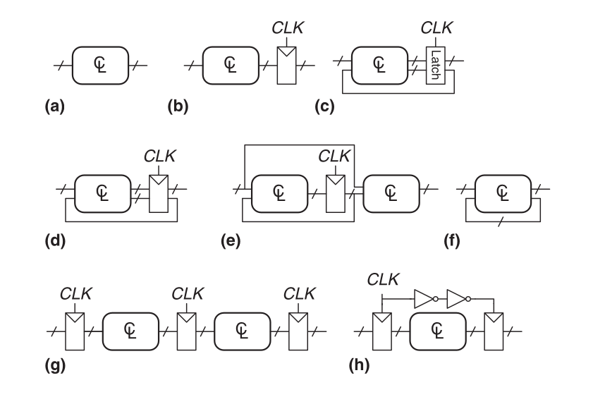
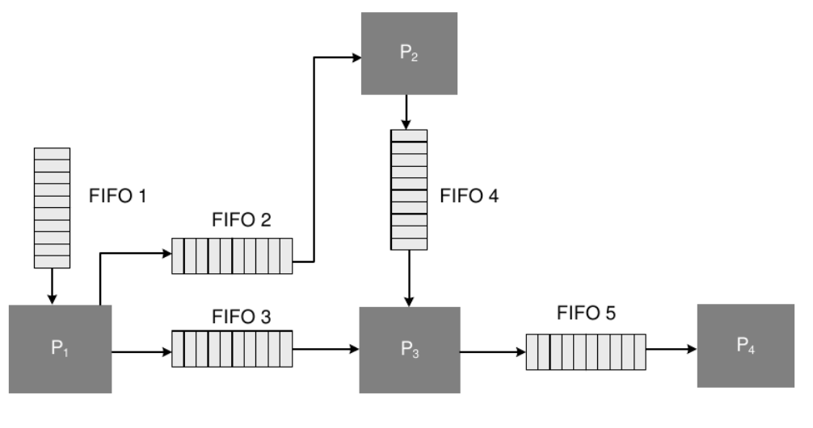
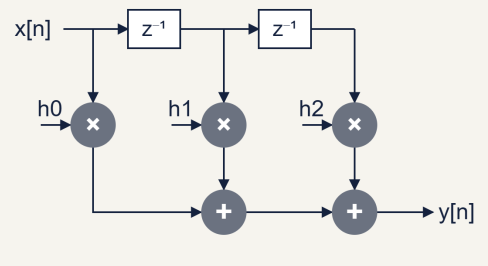
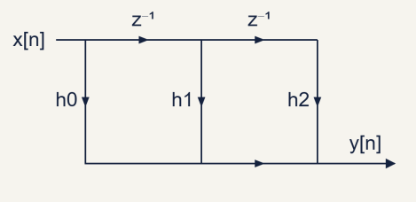
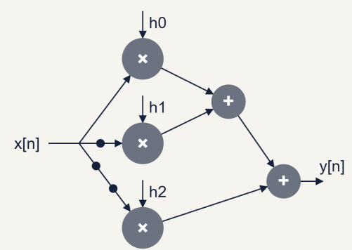
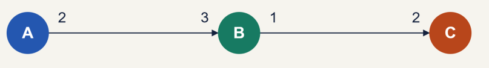
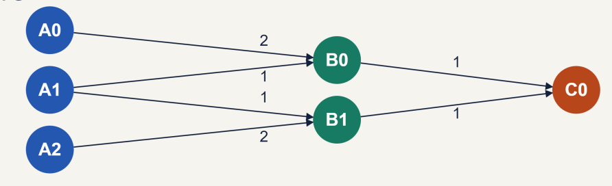

# Representacion de arquitecturas dedicadas

En un sistema de tiempo real discreto muchas veces encontraremos que a la entrada del sistema tendremos una señal de tiempo real (analogica) que es muestreada y convertida a digital mediante un ADC y posteriormente es procesada, tanto el tiempo de muestreo como el de procesamiento representan una gran limitacion al diseño del sistema. El procesamiento tiene que ser lo suficientemente rapido para completarse antes de que llegue un nuevo bloque de datos para ser procesados

## Tipos de sistemas de procesamiento

Se clasifican segun 2 caracteristicas:

### 1. Capacidad

- Bloques relativamente grandes: Aumenta los requerimientos de retardo y memoria.
- Bloques relativamente pequeños: Aumenta la sobrecarga de procesamiento.

### 2. Velocidad de procesamiento

- Tasa Única (Single-Rate): El número de muestras por segundo a la entrada y salida del sistema es el mismo, y el número de muestras por segundo no cambia cuando las muestras se mueven de un bloque a otro para su procesamiento.
- Multi-Tasa (Multi-Rate): Los datos se procesan a diferentes velocidades en bloques diferentes, en donde para cada bloque se especifica el número de muestras por segundo y dependiendo de si el sistema es un transmisor o un receptor, el número de muestras por segundo puede aumentar o disminuir respectivamente para el procesamiento posterior.

## Sistemas sincronos y asincronos

Un sistema digital es sincrónico cuando todos los cambios de estado en su lógica están controlados por un reloj, o por relojes con una relación de frecuencia y fase fija y conocida (por ejemplo, derivados de la misma fuente mediante un PLL o DLL).

Un sistema es asincrónico cuando sus cambios de estado no están coordinados por una referencia temporal común y conocida. Esto ocurre cuando:

- No hay reloj y el estado cambia directamente en respuesta a las entradas (con los retardos propios de las compuertas), o
- Hay partes con relojes independientes (sin relación de fase ni frecuencia conocida) que se comunican entre sí, o
- Una señal externa llega sin relación con el reloj interno (por ejemplo, la entrada RX de una UART).

En la imagen se ven distintos ejemplos de circuitos donde:

- a: Es un combinacional puro no tiene estados definidos
- b, d, e, g, h: Son sincronos porque dependen de un unico clock o de clocks dependientes entre si
- c, f: Son asincronos porque no dependen de un clock para cambiar sus estados

## Representacion mediantes redes de procesamiento de Kahn

Una red de procesamiento de Kahn (KPN, Kahn Process Network) es un modelo formal de cómputo para describir aplicaciones de flujo continuo (streaming). Consiste en un conjunto de procesos autónomos que se ejecutan de forma concurrente y se comunican entre sí únicamente a través de canales FIFO punto a punto. Consta de procesos, canales (memorias FIFO) y disparos.

Los canales unen procesos entre si, un disparo consiste en el envio de datos de una memoria a una proceso.

A partir de las redes de procesamiento de Kahn se presenta la jerarquia de modelos con limitaciones crecientes, osea mientras mas subimos en la jerarquia hay mas limitaciones en el modelo:

- KPN: los procesos pueden consumir y producir cualquier cantidad de datos en cada disparo, incluso dependiendo del valor de los datos.
- DFG: los procesos pasan a ser nodos (actores) que se disparan cuando tienen datos disponibles en sus entradas.
- SDFG: la cantidad de datos que consume y produce cada nodo en cada disparo es fija y conocida antes de ejecutar.
- HSDFG: cada nodo consume y produce un unico dato por disparo.

A cambio de las limitaciones se gana capacidad de analisis: en una KPN no se puede saber de antemano cuanta memoria van a necesitar los canales ni cuando se dispara cada proceso, mientras que en un SDFG todo eso se puede calcular de forma estatica (antes de ejecutar).

## Diagrama de bloques

Es la representacion mas intuitiva, el sistema se dibuja como un conjunto de bloques unidos por flechas, donde cada bloque es una operacion (sumador, multiplicador, retardo $z^{-1}$, o incluso un subsistema entero como un filtro o una FFT) y las flechas indican hacia donde viajan las señales.

Es util para entender el sistema a alto nivel y para dibujar las estructuras de filtros (forma directa, cascada, paralela, etc.), pero no tiene un significado formal sobre cuando se ejecuta cada bloque ni cuanto tarda, por lo que no sirve por si solo para analizar el rendimiento.

## Diagrama de flujo de señal (SFG)

Es una forma mas compacta y formal que el diagrama de bloques y se usa para sistemas lineales e invariantes en el tiempo. Se compone de:

- Nodos: representan las señales del sistema, cada nodo suma todas las señales que le llegan y su valor sale por todas las ramas que salen de el.
- Ramas: unen nodos y aplican una transferencia a la señal, que puede ser una ganancia constante o un retardo $z^{-1}$.
- Nodo fuente: nodo que solo tiene ramas salientes (la entrada).
- Nodo sumidero: nodo que solo tiene ramas entrantes (la salida).

Se usa para calcular la transferencia del sistema (por ejemplo con la regla de Mason) y para aplicar transformaciones como la transposicion: si se invierte el sentido de todas las ramas y se intercambian la entrada y la salida, la transferencia del sistema no cambia. Asi se obtiene por ejemplo la forma directa transpuesta de un FIR a partir de la forma directa.

## Grafo de flujo de datos (DFG)

En un DFG los nodos representan operaciones (calculos) y las aristas representan el camino de los datos entre operaciones. A diferencia del SFG se agrega informacion temporal:

- Cada nodo tiene asociado un tiempo de ejecucion (por ejemplo $T_a$ para un sumador y $T_m$ para un multiplicador).
- Cada arista tiene asociado un numero de retardos $D$ (registros), una arista con $D=0$ significa que el dato pasa directo de una operacion a la otra en la misma iteracion.

Un nodo se dispara cuando tiene todos los datos necesarios en sus entradas. Una iteracion es la ejecucion de todos los nodos una vez, y en un sistema de tasa unica cada iteracion procesa una muestra de entrada y genera una de salida.

Es la representacion base para aplicar las transformaciones de arquitectura como pipelining, retiming, unfolding y folding, y para calcular las medidas de rendimiento como el camino critico y la cota de iteracion.

## Grafo de flujo de datos sincrono (SDFG)

Es un DFG donde cada nodo, cada vez que se dispara, consume una cantidad fija de datos (tokens) de cada arista de entrada y produce una cantidad fija en cada arista de salida, y esas cantidades se conocen antes de ejecutar. Sobre cada arista se anota cuantos tokens produce el nodo de origen y cuantos consume el nodo de destino.

Como todo se conoce de antemano, el planificador (scheduler) puede decidir en tiempo de compilacion el orden en que se disparan los nodos y el tamaño de las memorias de los canales, sin necesidad de decidir nada en tiempo de ejecucion.

### SDFG Monotasa y multitasa

- Monotasa: en cada arista la cantidad producida es igual a la consumida, por lo que todos los nodos se disparan la misma cantidad de veces por iteracion.
- Multitasa: hay aristas donde lo que se produce es distinto a lo que se consume (por ejemplo un decimador por 2 consume 2 muestras y produce 1), por lo que los nodos se disparan una cantidad distinta de veces por iteracion.

En el caso multitasa hay que calcular cuantas veces se dispara cada nodo para que los canales no se llenen ni se vacien indefinidamente. Para cada arista que va de un nodo $i$ que produce $p$ tokens a un nodo $j$ que consume $c$ tokens se plantea la ecuacion de balance:

$$p \cdot q_i = c \cdot q_j$$

Donde $q_i$ y $q_j$ son la cantidad de disparos de cada nodo por iteracion. Juntando todas las ecuaciones se arma la matriz de topologia $\Gamma$ (una fila por arista y una columna por nodo) y se resuelve:

$$\Gamma \cdot \vec{q} = 0$$

El vector $\vec{q}$ de enteros positivos mas chico que cumple la ecuacion es el vector de repeticion. Si el grafo tiene $N$ nodos, solo existe solucion no nula si $rango(\Gamma) = N-1$, en ese caso se dice que el grafo es consistente. Si no es consistente algun canal acumula tokens infinitamente o se queda sin datos (deadlock).

Por ejemplo, si un nodo $A$ produce 2 tokens y un nodo $B$ consume 3, la ecuacion es $2 q_A = 3 q_B$, osea $\vec{q} = (3, 2)$: por cada iteracion $A$ se dispara 3 veces y $B$ 2 veces.

## SDFG Homogeneo (HSDFG)

Es el caso particular de SDFG donde todos los nodos consumen y producen un unico token por disparo en todas sus aristas, por lo que todos los nodos se disparan una vez por iteracion (vector de repeticion todo unos). Es equivalente al DFG de tasa unica que se usa para las transformaciones de arquitectura.

Cualquier SDFG consistente se puede convertir en un HSDFG replicando cada nodo $i$ tantas veces como indique $q_i$ y conectando las copias segun que token va a cada una. Esto permite usar sobre sistemas multitasa las mismas herramientas de analisis que sobre los de tasa unica, con la desventaja de que el grafo puede crecer mucho si los valores de $\vec{q}$ son grandes.

## Grafo de flujo de control y maquinas de estado finitas

Los modelos anteriores describen bien el procesamiento de datos (la parte de "calculo" del sistema) pero no sirven para describir comportamientos que dependen de decisiones, como un protocolo de comunicacion o un modo de funcionamiento que cambia segun una entrada. Para eso se usan:

- Grafo de flujo de control (CFG): los nodos son bloques de operaciones que se ejecutan siempre juntos y en orden (bloques basicos), y las aristas indican hacia que bloque se salta despues, pudiendo haber bifurcaciones segun una condicion (if, loops). Describe en que orden se ejecutan las cosas, no como fluyen los datos.
- Maquina de estados finita (FSM): el sistema se describe mediante un conjunto finito de estados, las transiciones entre ellos (que dependen de las entradas) y las salidas. Puede ser de Moore (la salida depende solo del estado) o de Mealy (la salida depende del estado y de las entradas). Es la forma natural de implementar un CFG en hardware, donde cada estado corresponde a un paso del control.

En la practica las arquitecturas dedicadas se dividen en un camino de datos (datapath), que se describe con DFG/SDFG, y una unidad de control, que se describe con una FSM y genera las señales que controlan al datapath (FSMD, FSM con datapath).

## Medidas de rendimiento

- Latencia: tiempo (o cantidad de ciclos de reloj) desde que entra una muestra hasta que sale el resultado correspondiente.
- Throughput (tasa de procesamiento): cantidad de muestras procesadas por unidad de tiempo. Puede ser alto aunque la latencia sea grande, por ejemplo en un sistema con pipeline.
- Periodo de muestreo: tiempo entre dos muestras de entrada consecutivas, es la inversa del throughput.
- Periodo de iteracion: tiempo que tarda el sistema en ejecutar una iteracion del DFG. En un sistema de tasa unica que procesa una muestra por iteracion coincide con el periodo de muestreo.
- Camino critico: el camino de mayor tiempo de ejecucion entre nodos que no tiene retardos ($D=0$) en el medio. Fija el periodo de reloj minimo $T_{clk} \ge T_{critico}$, y se puede reducir con pipelining o retiming.
- Cota de iteracion: en sistemas con lazos de realimentacion (por ejemplo un IIR) existe un limite para el periodo de iteracion que no se puede mejorar con pipelining ni retiming. Para cada lazo $l$ se calcula la cota del lazo como el tiempo total de los nodos del lazo $T_l$ dividido la cantidad de retardos del lazo $D_l$, y la cota de iteracion es la del peor lazo (lazo critico):

$$T_\infty = \max_{l} \left\{ \frac{T_l}{D_l} \right\}$$

- Area: cantidad de recursos de hardware usados (LUTs, flip-flops, DSPs, memoria en una FPGA).
- Potencia: consumo del sistema, que crece con la frecuencia de reloj y la cantidad de recursos que conmutan.

Normalmente estas medidas se contraponen entre si, por ejemplo el pipelining aumenta el throughput a cambio de mas latencia y mas area (registros), y el folding reduce el area reutilizando operadores a cambio de menos throughput.

## Elementos de una FPGA

Una vez que se tiene la arquitectura representada (DFG, FSM, etc.) hay que llevarla a los recursos que tiene la FPGA. Tomando como referencia la serie 7 de Xilinx (Artix-7, Kintex-7, etc.), los elementos principales son:

### CLB (Configurable Logic Block)

Es el bloque basico de logica, cada CLB tiene 2 slices y cada slice tiene:

- 4 LUTs de 6 entradas
- 8 flip-flops
- Una cadena de acarreo (carry chain) para hacer sumas y comparaciones rapidas
- Multiplexores (F7, F8) para unir LUTs y armar funciones de mas entradas

Hay dos tipos de slices: SLICEL (solo logica) y SLICEM, donde las LUTs ademas se pueden usar como memoria RAM chica (RAM distribuida) o como registros de desplazamiento (SRL).

### LUT (Look-Up Table)

Una LUT de 6 entradas es una memoria de $2^6 = 64$ bits donde las entradas funcionan como la direccion, osea que puede implementar cualquier funcion logica de hasta 6 entradas guardando su tabla de verdad. Por eso el retardo de una LUT es el mismo sin importar que funcion implementa, lo que importa es cuantas LUTs en serie (niveles de logica) hay entre dos registros. Una LUT6 tambien se puede usar como dos LUT5 que comparten las entradas.

### Flip-flops

Son los registros de la FPGA, flip-flops tipo D con clock enable y set/reset (sincronico o asincronico). Son los que cortan los caminos combinacionales, osea que en el DFG cada retardo $D$ termina siendo un flip-flop.

### Block RAM (BRAM)

Memorias dedicadas de 36 Kb (que se pueden usar como dos de 18 Kb), de doble puerto y con ancho de palabra configurable. Se usan para buffers grandes, tablas de coeficientes o FIFOs (tienen logica de FIFO integrada), osea para los canales de una KPN o SDFG cuando necesitan mucha memoria.

### DSP slice (DSP48E1)

Bloque dedicado para aritmetica, compuesto por:

- Un pre-sumador de 25 bits
- Un multiplicador de $25 \times 18$ bits
- Una ALU de 48 bits que puede funcionar como acumulador
- Registros de pipeline internos opcionales en cada etapa

Esta pensado para hacer la operacion de multiplicar y acumular (MAC) que es la base de los filtros FIR. Ademas los DSP se pueden conectar en cascada entre si sin pasar por el ruteo general, y el pre-sumador permite aprovechar la simetria de los FIR de fase lineal (sumar las dos muestras antes de multiplicar por el mismo coeficiente). Hacer un multiplicador con LUTs es posible pero ocupa muchos mas recursos y es mas lento.

### IOB (Input/Output Block)

Son los bloques que conectan los pines de la FPGA con la logica interna. Tienen buffers de entrada/salida configurables (estandar de tension, impedancia) y registros propios, por lo que se puede registrar una señal apenas entra o justo antes de salir.

### Interconexion (ruteo)

Es la red de cables programables que une todos los elementos anteriores. Es importante tenerla en cuenta porque en una FPGA una buena parte del retardo de un camino no esta en la logica sino en el ruteo.

## Clock

El clock se distribuye por una red dedicada (buffers globales BUFG y buffers regionales) para que llegue a todos los flip-flops casi al mismo tiempo (poco skew). Para generar los clocks que necesita el diseño a partir del clock de la placa se usa un administrador de clock (DCM, Digital Clock Manager). En la serie 7 esto lo hace el CMT (Clock Management Tile), que tiene dos opciones: el MMCM y el PLL.

Ambos funcionan con un oscilador controlado por tension (VCO) cuya frecuencia se obtiene multiplicando la entrada, y despues cada salida divide esa frecuencia:

$$F_{VCO} = F_{in} \cdot \frac{M}{D} \qquad F_{out} = \frac{F_{VCO}}{O} = F_{in} \cdot \frac{M}{D \cdot O}$$

Donde $M$ es el factor de multiplicacion, $D$ el divisor de entrada y $O$ el divisor de cada salida. La $F_{VCO}$ tiene que quedar dentro de un rango permitido que depende del dispositivo (por ejemplo alrededor de 600 a 1200 MHz para un MMCM de grado de velocidad -1).

Ademas de cambiar la frecuencia sirven para:

- Eliminar el skew (deskew): compensan el retardo de la red de clock para que el clock interno quede alineado con el externo.
- Filtrar el jitter del clock de entrada.
- Desfasar el clock (phase shift).

### MMCM (Mixed-Mode Clock Manager)

Es el mas completo:

- 7 salidas
- Division fraccionaria (en pasos de 1/8) en $M$ y en una de las salidas, por lo que se pueden obtener mas frecuencias exactas
- Desfase fino y dinamico (se puede cambiar en funcionamiento)
- Salidas invertidas y spread spectrum

### PLL (Phase-Locked Loop)

Es una version reducida del MMCM:

- 6 salidas
- Solo division entera
- Menos opciones de desfase

A cambio consume menos y su VCO llega a frecuencias mas altas. Se usa cuando no se necesitan las funciones extra del MMCM (o para dejar el MMCM libre para otra cosa).

En los dos casos hay una salida `LOCKED` que indica cuando el clock de salida ya es estable, por lo que es buena practica mantener el sistema en reset hasta que `LOCKED` este en alto. En Vivado se configuran con el Clocking Wizard, que calcula $M$, $D$ y $O$ a partir de las frecuencias pedidas.

## Medicion de retardos en la FPGA

Para verificar que el sistema funciona a la frecuencia pedida se hace un analisis estatico de tiempos, que divide el diseño en caminos que empiezan y terminan en un registro o en un pin. Se definen los siguientes tiempos:

- $T_{co}$: retardo de clock a salida del flip-flop (desde el flanco hasta que el dato aparece en $Q$)
- $T_{logica}$: retardo de las LUTs, DSPs, etc. del camino
- $T_{ruteo}$: retardo de la interconexion
- $T_{setup}$ y $T_{hold}$: tiempos de setup y hold del flip-flop destino
- $T_{skew}$: diferencia de llegada del clock entre el registro de origen y el de destino

### Reg to reg

Es el camino interno entre dos flip-flops del mismo clock y es el que fija la frecuencia maxima del diseño. Para cumplir setup:

$$T_{clk} \ge T_{co} + T_{logica} + T_{ruteo} + T_{setup} - T_{skew}$$

Por lo que la frecuencia maxima es:

$$F_{max} = \frac{1}{T_{co} + T_{logica} + T_{ruteo} + T_{setup} - T_{skew}}$$

El camino reg to reg mas lento es el camino critico del DFG ya implementado, y se mejora con las mismas tecnicas (pipelining, retiming) o usando los registros internos de los DSP y BRAM. Para cumplir hold tiene que pasar:

$$T_{co} + T_{logica} + T_{ruteo} \ge T_{hold} + T_{skew}$$

### Input to reg

Es el camino desde un pin de entrada hasta el primer flip-flop. Aca hay que sumar el tiempo que tarda el dispositivo externo en poner el dato despues del flanco ($T_{ext}$), que se le indica a Vivado con `set_input_delay`:

$$T_{clk} \ge T_{ext} + T_{logica} + T_{ruteo} + T_{setup}$$

### Reg to output

Es el camino desde el ultimo flip-flop hasta un pin de salida. Hay que dejarle al dispositivo externo el tiempo que necesita para capturar el dato ($T_{ext}$), que se indica con `set_output_delay`:

$$T_{clk} \ge T_{co} + T_{logica} + T_{ruteo} + T_{ext}$$

Tambien puede existir un camino input to output puramente combinacional (de pin a pin sin pasar por registros), que conviene evitar porque su retardo no esta controlado por el clock.

Una buena practica es registrar las entradas y salidas lo mas cerca posible del pin (usando los registros del IOB), asi los caminos input to reg y reg to output quedan lo mas cortos posibles y la frecuencia queda limitada solo por los caminos reg to reg. Las metricas que muestra Vivado para estos caminos (WNS, WHS, etc.) estan explicadas en [metricas_timing.md](metricas_timing.md).
