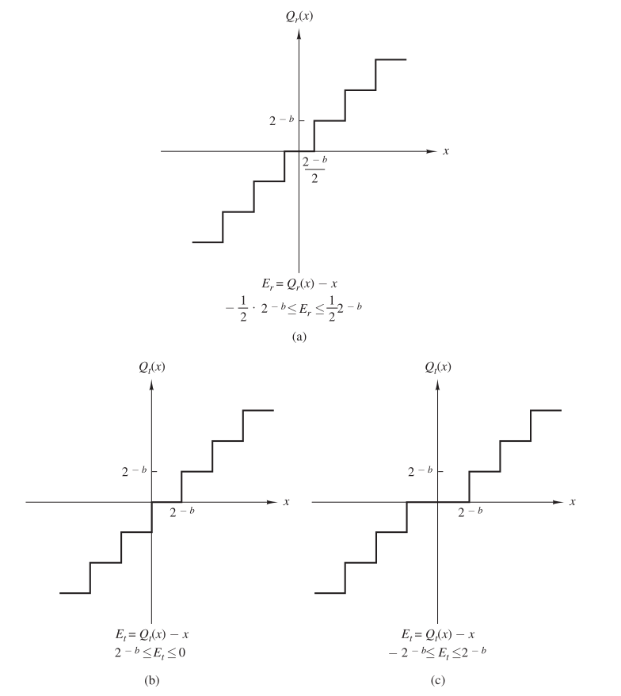
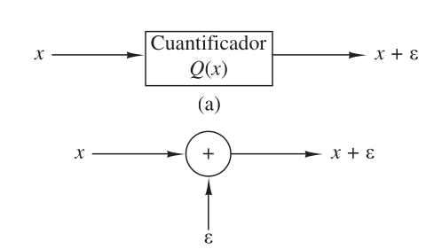
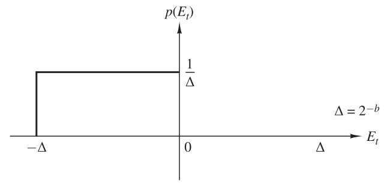
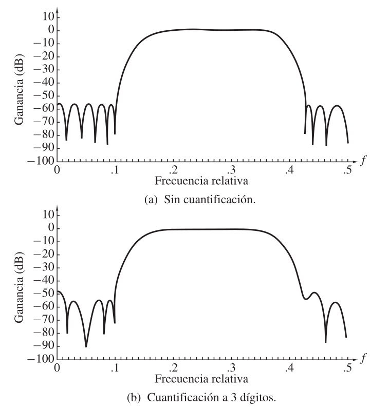
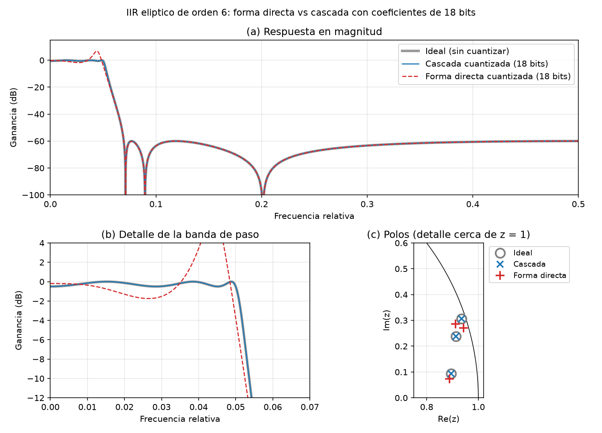
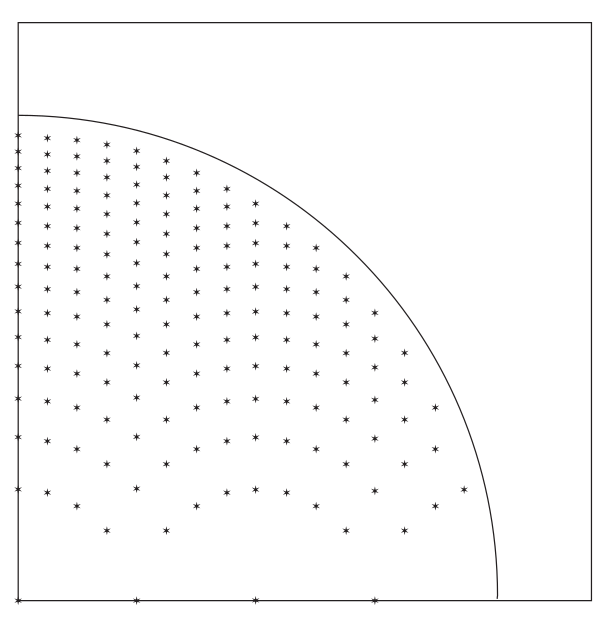
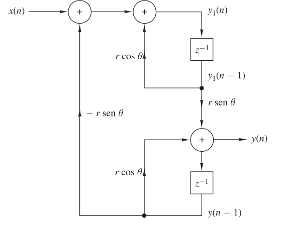
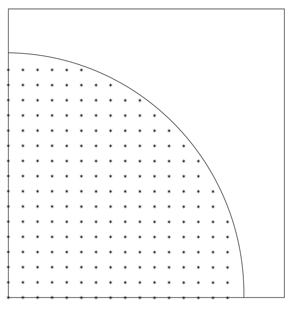

# Aritmetica de punto flotante

En punto flotante un numero real se representa mediante un signo, una mantisa y un exponente:

$$X = (-1)^s \cdot M \cdot 2^E$$

Donde $s$ es el bit de signo, $M$ es la mantisa (los digitos significativos del numero) y $E$ es el exponente (que indica donde esta la coma). A diferencia del punto fijo, la coma "flota": el exponente se ajusta para cada numero, por lo que se pueden representar numeros muy grandes y muy chicos con la misma cantidad de bits.

La consecuencia de esto es que el error que se comete al representar un numero es relativo y no absoluto, osea que es proporcional al tamaño del numero. Un numero grande tiene un error absoluto grande y uno chico un error absoluto chico, pero en ambos casos se tiene la misma cantidad de digitos significativos correctos.

La desventaja es el hardware: para sumar dos numeros primero hay que alinear sus exponentes (desplazar la mantisa del mas chico), sumar las mantisas y despues normalizar el resultado, por lo que un sumador de punto flotante es mucho mas grande y lento que uno de punto fijo.

## Estandar IEEE-754

El estandar IEEE-754 define como se ubican el signo, el exponente y la mantisa dentro de la palabra binaria. Los dos formatos mas usados son:

| Formato | Bits totales | Signo | Exponente | Mantisa (fraccion) | Sesgo |
|---|---|---|---|---|---|
| Simple precision | 32 | 1 | 8 | 23 | 127 |
| Doble precision | 64 | 1 | 11 | 52 | 1023 |

El valor representado (para numeros normalizados) es:

$$X = (-1)^s \cdot 1.f \cdot 2^{E-sesgo}$$

Donde se tienen en cuenta dos detalles:

- La mantisa se normaliza para que siempre empiece con un 1 antes de la coma ($1.f$), como ese 1 esta siempre no se guarda (bit implicito) y se gana un bit de precision. Solo se guarda la fraccion $f$.
- El exponente no se guarda en complemento a 2 sino con un sesgo: se guarda $E = e + sesgo$, donde $e$ es el exponente real. Asi el exponente guardado siempre es positivo y dos numeros se pueden comparar como si fueran enteros.

Algunas combinaciones del exponente estan reservadas para casos especiales:

- $E=0$ y $f=0$: el cero ($\pm 0$ segun el signo)
- $E=0$ y $f \ne 0$: numeros subnormales, $X=(-1)^s \cdot 0.f \cdot 2^{1-sesgo}$, que permiten representar numeros mas chicos que el minimo normalizado perdiendo precision de a poco
- $E$ todos unos y $f=0$: $\pm \infty$
- $E$ todos unos y $f \ne 0$: NaN (Not a Number), resultado de operaciones invalidas como $0/0$

Por ejemplo para representar $-6.25$ en simple precision:

$$-6.25 = -110.01_2 = -1.1001_2 \cdot 2^{2}$$

osea $s=1$, $E=2+127=129=10000001_2$ y $f=1001000...0$, quedando:

$$1 \ | \ 10000001 \ | \ 10010000000000000000000 = \text{0xC0C80000}$$

En simple precision el numero normalizado mas grande es aproximadamente $3.4 \cdot 10^{38}$, el mas chico $2^{-126} \approx 1.18 \cdot 10^{-38}$ y la precision relativa es $2^{-23} \approx 1.19 \cdot 10^{-7}$ (unos 7 digitos decimales). En doble precision la precision relativa es $2^{-52} \approx 2.22 \cdot 10^{-16}$ (unos 16 digitos decimales). Por defecto el estandar redondea al valor representable mas cercano (y en caso de empate al que termina en 0).

# Aritmetica de punto fijo

En punto fijo la coma esta siempre en la misma posicion, osea que se tiene una cantidad fija de bits para la parte entera y otra para la parte fraccionaria. Se usa la notacion $U(N,F)$ para numeros sin signo y $S(N,F)$ para numeros con signo, donde $N$ es la cantidad de bits totales y $F$ la cantidad de bits fraccionarios (la parte entera tiene $N-F$ bits, incluyendo el signo en el caso de $S$). En ambos casos el paso entre dos numeros consecutivos es $2^{-F}$ y los rangos son:

$$U(N,F): \quad 0 \le X \le 2^{N-F} - 2^{-F}$$

$$S(N,F): \quad -2^{N-F-1} \le X \le 2^{N-F-1} - 2^{-F}$$

Por ejemplo $U(8,6)$ tiene 8 bits totales de los cuales 6 son fraccionarios y 2 enteros, por lo que representa numeros entre $0$ y $4 - \frac{1}{64} = 3.984375$ con un paso de $\frac{1}{64}$.

La representacion de numeros con signo se realiza mediante complemento a 2. En el formato mas usado en filtros se tiene 1 bit de signo y $B$ bits fraccionarios ($S(B+1,B)$), por lo que los numeros estan entre $-1$ y $1$, y el valor de una palabra $b_0 . b_1 b_2 ... b_B$ es:

$$X = -b_0 + \sum_{i=1}^{B} b_i \cdot 2^{-i}$$

La distancia entre dos numeros representables consecutivos es el paso de cuantizacion:

$$\Delta = 2^{-B}$$

y el rango representable es $-1 \le X \le 1 - 2^{-B}$. Por ejemplo con $S(5,4)$:

$$0.6875 = 0.1011_2 \qquad -0.6875 = 1.0101_2 = -1 + 0.25 + 0.0625$$

Existen otras representaciones (signo y magnitud, complemento a 1) pero se usa complemento a 2 porque tiene un unico cero, la suma y la resta se hacen con el mismo circuito sin importar el signo, y si el resultado final de una suma de varios terminos entra en el rango, el resultado es correcto aunque alguna suma intermedia haya desbordado.

Las operaciones en punto fijo tienen dos problemas distintos:

- La suma no genera bits fraccionarios nuevos pero puede generar overflow, osea un resultado que no entra en el rango (esto se analiza en dimensionamiento_de_bits.md).
- La multiplicacion de dos numeros de $B$ bits fraccionarios da un resultado con $2B$ bits fraccionarios, por lo que para volver a guardarlo en $B$ bits hay que cuantizarlo y se comete un error.

## Cuantizacion: truncamiento y redondeo

Cuantizar es llevar un numero $x$ a uno representable $Q(x)$ con $B$ bits fraccionarios, cometiendo un error $e = Q(x) - x$. Hay dos formas de hacerlo:

Truncamiento: se descartan los bits que sobran. En complemento a 2 esto siempre lleva el numero hacia abajo (hacia $-\infty$), por lo que el error es:

$$-\Delta < e_t \le 0$$

Redondeo: se elige el numero representable mas cercano (en hardware equivale a sumar $\Delta/2$ y despues truncar), por lo que el error es:

$$-\frac{\Delta}{2} \le e_r \le \frac{\Delta}{2}$$

En la figura (a) es el redondeo, (b) el truncamiento en complemento a 2 y (c) el truncamiento en signo y magnitud, donde los numeros negativos se truncan hacia cero y por lo tanto el error queda entre $-\Delta$ y $\Delta$. En la figura $b$ es la cantidad de bits fraccionarios ($B$ en este resumen) y en (b) falta un signo menos, el error va de $-2^{-b}$ a $0$.

Para analizar los efectos sobre un sistema el cuantizador se reemplaza por un sumador que le agrega a la señal un error $\varepsilon$, osea que la cuantizacion se trata como una señal de ruido que se suma:

Ademas el error se modela como una variable aleatoria uniforme en ese intervalo, independiente de la señal. Con esto el redondeo tiene media $0$ y el truncamiento media $-\frac{\Delta}{2}$ (introduce un sesgo), y en ambos casos la varianza es:

$$\sigma_e^2 = \frac{\Delta^2}{12} = \frac{2^{-2B}}{12}$$

Por ejemplo para el truncamiento en complemento a 2 la densidad de probabilidad del error es un rectangulo de altura $\frac{1}{\Delta}$ entre $-\Delta$ y $0$ (en el redondeo es el mismo rectangulo centrado en $0$):

Se ve que cada bit agregado divide el error por 2, osea que mejora el piso de error en $20 \cdot \log_{10}(2) \approx 6$ dB.

Por ejemplo cuantizando $x=0.3$ con $B=4$ ($\Delta = 0.0625$): $0.3 \cdot 16 = 4.8$, redondeando queda $\frac{5}{16} = 0.3125$ con un error de $0.0125$, que es menor a $\frac{\Delta}{2} = 0.03125$. Truncando queda $\frac{4}{16} = 0.25$ con un error de $-0.05$.

Cuando hay overflow se puede dejar que el resultado "de la vuelta" (wrap-around, que es lo que hace naturalmente el complemento a 2: un numero positivo grande pasa a ser negativo) o saturar (clampear el resultado al valor maximo o minimo representable). La saturacion necesita un poco mas de hardware pero el error es mucho menor.

La diferencia principal con punto flotante es que en punto fijo el error absoluto es constante ($\Delta$) sin importar el tamaño del numero, por lo que los numeros chicos tienen un error relativo grande. Por eso en punto fijo conviene escalar las señales y los coeficientes para usar todo el rango disponible.

# Efectos de cuantizacion en filtros

La cuantizacion de los coeficientes de un filtro es una consecuencia debido a que los coeficientes son representados ya sea en hardware o software mediante registros de tamaño finito, esto deriva en que se va a tener un coeficiente y un error asociado debido a la cuantizacion del mismo

Si $h$ es el coeficiente ideal, el coeficiente cuantizado es $h_q = h + e$, por lo que el filtro que realmente se implementa no es $H(z)$ sino:

$$H_q(z) = H(z) + E(z)$$

Donde $E(z)$ es la funcion de transferencia formada por los errores de cuantizacion de cada coeficiente. Como los coeficientes cambian, cambian los ceros y los polos del filtro y por lo tanto su respuesta en frecuencia. Este error es fijo (no depende de la señal) y se puede verificar antes de implementar el filtro.

Ademas de los coeficientes, en un filtro tambien se cuantizan los resultados de las multiplicaciones (ruido de redondeo) y puede haber overflow en las sumas, por lo que en total se tienen tres efectos:

- Cuantizacion de los coeficientes: cambia $H(z)$
- Cuantizacion de los productos: agrega ruido a la salida
- Overflow: errores grandes si los registros no tienen suficientes bits

## Efectos de la cuantizacion en filtros FIR

En un FIR los coeficientes son directamente la respuesta al impulso, por lo que el error es:

$$h_q[n] = h[n] + e[n] \qquad E(e^{j\omega}) = \sum_{n=0}^{M-1} e[n] \cdot e^{-j\omega n}$$

Como cada $|e[n]| \le \frac{\Delta}{2}$ (redondeando), en el peor caso el error en la respuesta en frecuencia esta acotado por:

$$|E(e^{j\omega})| \le \sum_{n=0}^{M-1} |e[n]| \le M \cdot \frac{\Delta}{2}$$

y usando el modelo estadistico (errores independientes con varianza $\frac{\Delta^2}{12}$) el error tipico es:

$$\sigma_E^2 = M \cdot \frac{\Delta^2}{12}$$

Se ve que el error crece con la longitud del filtro y disminuye con la cantidad de bits. Este error es mas o menos parejo en todas las frecuencias, por lo que en la banda de paso (donde $|H| \approx 1$) casi no se nota, pero en la banda de rechazo (donde $|H|$ es muy chico) el error puede ser comparable al valor de $|H|$ y lo que se pierde es atenuacion: el piso de la banda de rechazo sube.

En la figura se ve un filtro pasabanda FIR sin cuantizar y con los coeficientes cuantizados a 3 digitos, la banda de paso practicamente no cambia pero la banda de rechazo pasa de unos $-55$ dB a unos $-48$ dB y los lobulos dejan de ser parejos:

Algunas propiedades importantes de los FIR frente a la cuantizacion:

- Siempre son estables, ya que no tienen polos que se puedan mover fuera del circulo unitario.
- No tienen realimentacion, por lo que el ruido de redondeo de los productos no se recircula, simplemente se suma a la salida (con varianza $\frac{\Delta^2}{12}$ por cada producto cuantizado, o una sola vez si se usa un acumulador de doble ancho y se cuantiza solo la salida).
- La fase lineal se conserva en la forma directa y en la forma directa de fase lineal, ya que $h[k]$ y $h[M-1-k]$ son el mismo numero y se cuantizan igual, por lo que la simetria se mantiene. En la cascada comun en cambio se cuantizan por separado las etapas con $c_i$ y con $\frac{1}{c_i}$ y se pierde la fase lineal, salvo en la cascada de fase lineal donde cada etapa es simetrica.
- En filtros con muchos ceros agrupados (por ejemplo los ceros sobre el circulo unitario en la banda de rechazo de un filtro angosto) la forma directa es sensible porque cada cero depende de todos los coeficientes, igual que pasa con los polos en IIR. La cascada reduce esa sensibilidad.

### Estrategia de diseño

1. Diseñar el filtro con coeficientes ideales dejando margen en la especificacion, por ejemplo pidiendo unos dB mas de atenuacion de los necesarios, ya que la cuantizacion la va a empeorar.
2. Escalar los coeficientes para aprovechar todo el rango del formato, normalizando por el coeficiente de mayor valor absoluto (de ser posible con una potencia de 2, para que la ganancia se corrija con un desplazamiento).
3. Cuantizar los coeficientes redondeando (no truncando) y calcular la respuesta en frecuencia del filtro cuantizado.
4. Verificar que se siga cumpliendo la especificacion, principalmente la atenuacion en la banda de rechazo. Como regla practica cada bit extra mejora unos 6 dB el piso de error.
5. Si no cumple, aumentar la cantidad de bits $B$, pasar a una estructura menos sensible (cascada) o rediseñar el filtro con mas margen.
6. Si el filtro es de fase lineal usar una estructura que conserve la simetria (forma directa de fase lineal o cascada de fase lineal).
7. Dimensionar los acumuladores para que no haya overflow (dimensionamiento_de_bits.md) y cuantizar solo a la salida para minimizar el ruido de redondeo.

## Efectos de la cuantizacion en filtros IIR

En un IIR el problema principal es la cuantizacion de los coeficientes del denominador, ya que mueve los polos y estos determinan la estabilidad. Partiendo del denominador:

$$D(z) = 1 + \sum_{k=1}^{N} a_k \cdot z^{-k} = \prod_{i=1}^{N} (1 - p_i \cdot z^{-1})$$

si cada coeficiente cambia en $\Delta a_k$, el polo $p_i$ se mueve aproximadamente:

$$\Delta p_i = \sum_{k=1}^{N} \frac{\partial p_i}{\partial a_k} \cdot \Delta a_k$$

Escribiendo $D$ en potencias positivas, $D(z) = z^N + \sum_{k=1}^{N} a_k \cdot z^{N-k} = \prod_{l=1}^{N}(z - p_l)$, y derivando implicitamente $D(p_i)=0$ respecto de $a_k$:

$$p_i^{N-k} + \prod_{l \ne i}(p_i - p_l) \cdot \frac{\partial p_i}{\partial a_k} = 0$$

por lo que:

$$\Delta p_i = -\sum_{k=1}^{N} \frac{p_i^{N-k}}{\prod_{l \ne i}(p_i - p_l)} \cdot \Delta a_k$$

El denominador $\prod_{l \ne i}(p_i - p_l)$ es el producto de las distancias del polo $p_i$ a todos los demas polos. Por lo tanto la sensibilidad es grande cuando:

- Los polos estan muy cerca entre si, como pasa en filtros muy selectivos (pasabanda angostos, frecuencias de corte muy bajas o muy altas) donde todos los polos se agrupan en una zona chica cerca del circulo unitario.
- El orden $N$ es grande, ya que cada polo depende de todos los coeficientes y hay mas terminos en la suma.

Si los polos estan cerca del circulo unitario, un movimiento chico puede sacarlos afuera y el filtro se vuelve inestable. Por eso no se implementan IIR de orden alto en forma directa sino en cascada o paralelo de secciones de segundo orden: en cada seccion un polo solo "ve" a su conjugado, por lo que la sensibilidad depende de la distancia entre $p_i$ y $p_i^*$ y no de la distancia a todos los demas.

Para ver la diferencia entre la forma directa y la cascada se tomo un filtro eliptico pasabajos de orden 6 (frecuencia de corte $0.05$, rizado de $0.5$ dB y $60$ dB de atenuacion) y se cuantizaron sus coeficientes con palabras de 18 bits en las dos estructuras. En forma directa los coeficientes del denominador llegan a valer casi 16 ($a_3 \approx -15.85$), por lo que se necesitan 5 bits enteros y quedan solo 13 fraccionarios ($S(18,13)$), mientras que en la cascada los coeficientes de cada seccion son menores a 2 y quedan 16 bits fraccionarios ($S(18,16)$):

Se ve que con los mismos 18 bits la cascada es practicamente igual al filtro ideal, mientras que en la forma directa los polos se mueven, el rizado de la banda de paso pasa de $0.5$ dB a un pico de unos $+7$ dB y se corre la frecuencia de corte. Con solo 2 bits menos (16 bits) el polo mas cercano al circulo unitario de la forma directa pasa a tener modulo $1.07$, osea que el filtro directamente se vuelve inestable, mientras que la cascada sigue funcionando.

Seccion de segundo orden

Para una seccion con polos $p = r \cdot e^{\pm j\theta}$:

$$D(z) = 1 - 2r\cos\theta \cdot z^{-1} + r^2 \cdot z^{-2} \qquad a_1 = -2r\cos\theta \qquad a_2 = r^2$$

Al cuantizar $a_1$ se cuantiza la parte real del polo $r\cos\theta$ en pasos iguales, pero al cuantizar $a_2$ se cuantiza $r^2$, osea que los radios posibles son $\sqrt{k \cdot \Delta}$. El resultado es que las posiciones posibles de los polos no forman una grilla uniforme: hay muy pocas cerca del eje real en $z = \pm 1$, osea que los filtros con polos a frecuencias muy bajas o muy altas son los que mas sufren la cuantizacion.

En la figura se ven las posiciones posibles de los polos en el primer cuadrante para la forma directa, donde se nota que cerca del eje real (sobre todo cerca de $z=1$) casi no hay posiciones:

Ademas para que la seccion sea estable los coeficientes tienen que estar dentro del triangulo de estabilidad:

$$|a_2| < 1 \qquad |a_1| < 1 + a_2$$

por lo que $a_1$ puede valer hasta 2 en modulo y su formato necesita un bit entero mas que el de los demas coeficientes (por ejemplo $S(B+2,B)$ en lugar de $S(B+1,B)$).

Forma acoplada

Para tener una grilla uniforme se puede usar la forma acoplada, que usa como coeficientes directamente la parte real y la parte imaginaria del polo:

$$y_1[n] = x[n] + r\cos\theta \cdot y_1[n-1] - r\sin\theta \cdot y[n-1]$$

$$y[n] = r\sin\theta \cdot y_1[n-1] + r\cos\theta \cdot y[n-1]$$

Como se cuantizan $r\cos\theta$ y $r\sin\theta$ por separado, las posiciones posibles de los polos forman una grilla rectangular uniforme. La desventaja es que requiere 4 multiplicaciones en lugar de 2 para implementar los polos.

Ruido de redondeo y ciclos limite

En un IIR los productos cuantizados estan dentro del lazo de realimentacion, por lo que el ruido de redondeo pasa por los polos y se amplifica. Si una fuente de ruido de varianza $\sigma_e^2 = \frac{\Delta^2}{12}$ llega a la salida a traves de un sistema con respuesta al impulso $h_e[n]$, la varianza del ruido a la salida es:

$$\sigma_y^2 = \sigma_e^2 \cdot \sum_{n=0}^{\infty} h_e^2[n]$$

Con polos cerca del circulo unitario $h_e[n]$ decae lento y la suma es grande, por lo que los filtros selectivos tambien son los mas ruidosos.

Ademas por la realimentacion pueden aparecer ciclos limite: oscilaciones que se mantienen en la salida aunque la entrada sea cero, porque el redondeo dentro del lazo impide que la salida decaiga hasta cero. Son de amplitud chica (unos pocos $\Delta$). Si en cambio hay overflow con wrap-around dentro del lazo pueden aparecer oscilaciones de amplitud completa, por eso en los IIR se usa saturacion.

### Estrategia de diseño

1. No implementar IIR de orden alto en forma directa, descomponer en secciones de segundo orden en cascada o paralelo (en MATLAB/Python pedir el filtro directamente en formato SOS con tf2sos o zp2sos).
2. Emparejar cada par de polos con el par de ceros mas cercano y elegir el orden de las secciones, ya que esto cambia el ruido de redondeo y el riesgo de overflow.
3. Elegir el formato de los coeficientes teniendo en cuenta que $a_1$ puede llegar a 2 en modulo (un bit entero mas).
4. Cuantizar los coeficientes y verificar que todos los polos sigan dentro del circulo unitario ($|p_i| < 1$, o el triangulo de estabilidad en cada seccion) y que la respuesta en frecuencia siga cumpliendo la especificacion.
5. Escalar la señal entre secciones para que no haya overflow (dimensionamiento_de_bits.md) sin desperdiciar rango, ya que escalar de mas aumenta el ruido relativo.
6. Usar acumuladores de doble ancho y saturacion para evitar las oscilaciones por overflow y reducir el ruido de redondeo.
7. Si hay polos muy cerca de $z = \pm 1$ y la grilla de la forma directa no alcanza, aumentar $B$ o usar la forma acoplada.
