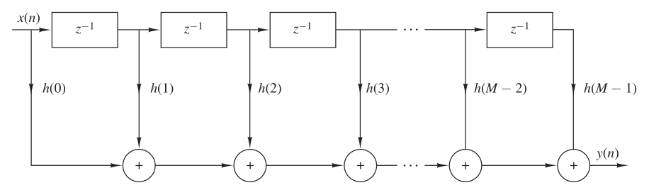
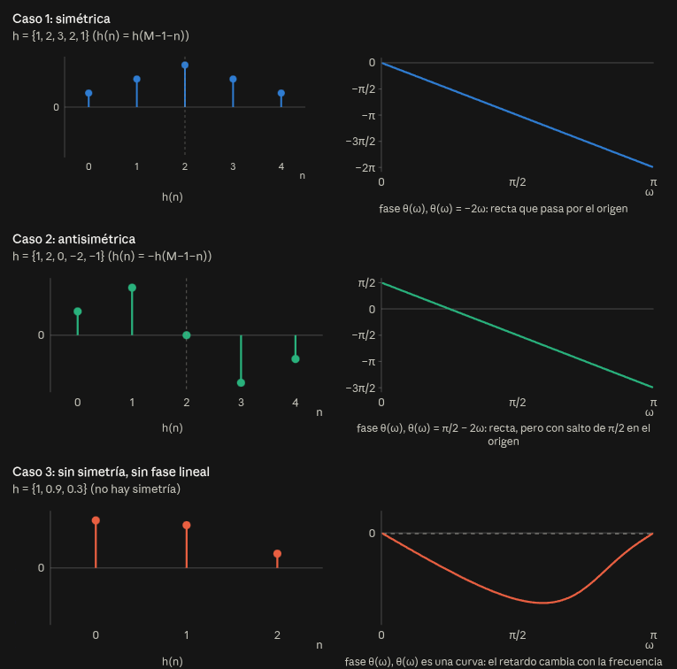
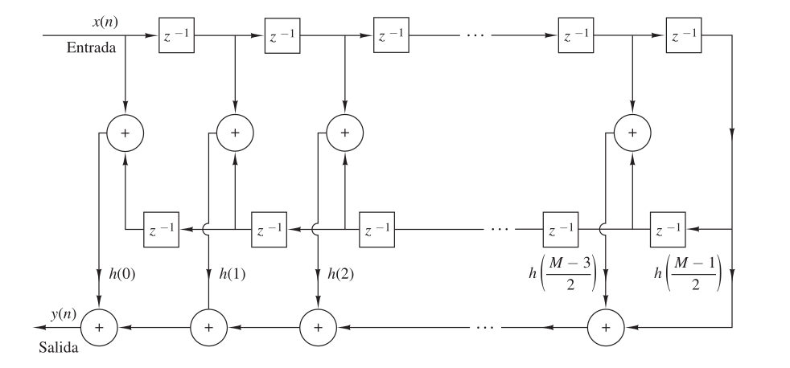
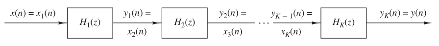
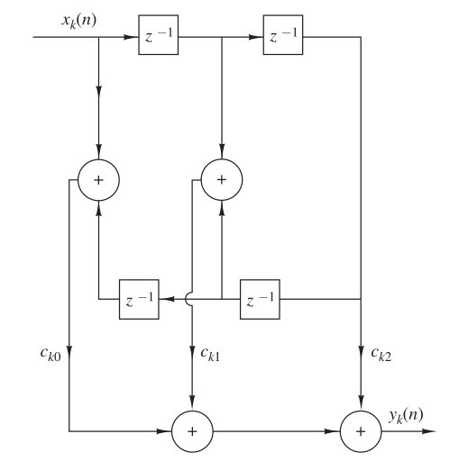
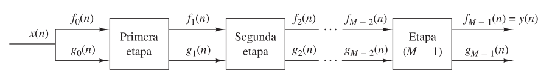
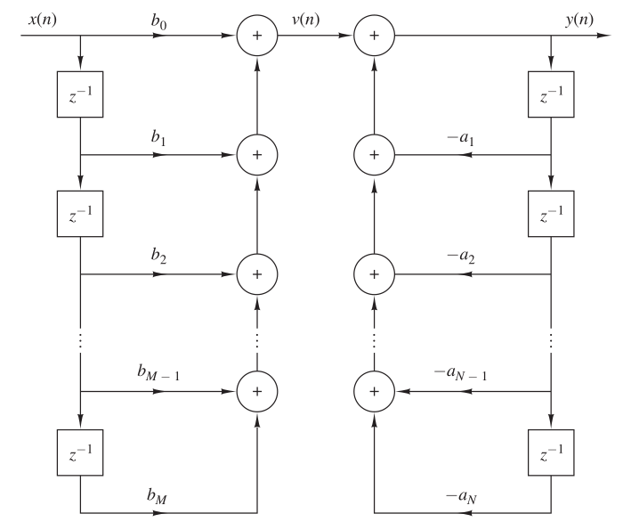
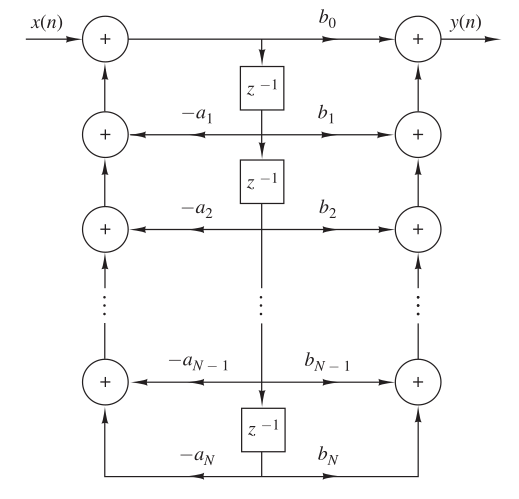
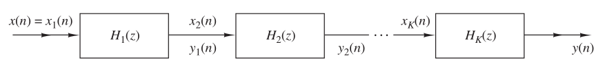
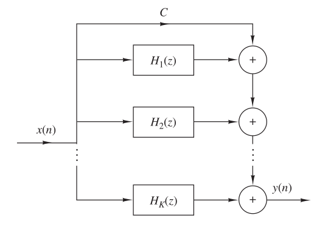

# Implementacion de sistemas discretos en el tiempo

## Estructuras para sistemas FIR

En general un sistema FIR se describe mediante la siguiente ecuacion en diferencias:

$$y[n]=\sum_{k=0}^{M-1}b_k \cdot x[n-k]$$

o de manera equivalente mediante la funcion de transferencia del sistema:

$$H(z)=\sum_{k=0}^{M-1}b_k \cdot z^{-k}$$

Donde los coeficientes $b_k=h[k]$ se llaman parametros del sistema

### Forma directa

Esta estructura como su nombre lo indica se obtiene al implementar el sistema en base a la ecuacion del sistema:

$$y[n]=\sum_{k=0}^{M-1} h[k] \cdot x[n-k]$$

Esta estructura requiere:

- $M-1$ posiciones en memoria
- $M-1$ sumas
- $M$ multiplicaciones

#### Fase lineal

Un filtro tiene fase lineal cuando la fase de su respuesta en frecuencia es una función lineal de $\omega$:

$$H(e^{j\omega}) = H_r(\omega)\, e^{j\theta(\omega)}, \qquad \theta(\omega) = -\alpha\,\omega$$

Es decir, la respuesta en frecuencia se puede escribir como una amplitud real $H_r(\omega)$ multiplicada por $e^{-j\alpha\omega}$ ($H_r(\omega)$ puede ser negativa, por eso no es exactamente $|H(e^{j\omega})|$).

Físicamente:

Una fase lineal equivale a un retardo puro de $\alpha$ muestras, el mismo para todas las frecuencias. Esto se ve con la propiedad de desplazamiento: multiplicar por $e^{-j\omega\alpha}$ en frecuencia es retardar $\alpha$ muestras en el tiempo.

La forma de medirlo es el retardo de grupo:

$$\tau_g(\omega) = -\frac{d\theta(\omega)}{d\omega}$$

Si $\theta(\omega) = -\alpha\omega$, entonces $\tau_g(\omega) = \alpha$ es constante: todas las componentes de frecuencia llegan a la salida con el mismo retardo.

Un FIR de longitud $M$ con respuesta al impulso $h[n]$, $0 \le n \le M-1$, tiene fase lineal si $h[n]$ es simétrica o antisimétrica respecto de su centro:

$$h[n] = \pm\, h[M-1-n]$$

Simétrica ($h[n] = h[M-1-n]$):

$$\theta(\omega) = -\omega\,\frac{M-1}{2}$$

Antisimétrica ($h[n] = -h[M-1-n]$):

$$\theta(\omega) = \frac{\pi}{2} - \omega\,\frac{M-1}{2}$$

En ambos casos el retardo de grupo es constante e igual a

$$\tau_g = \frac{M-1}{2} \text{ muestras}$$

(en el caso antisimétrico la fase tiene un desfase constante de $\pi/2$, por eso se llama fase lineal generalizada).

##### Demostración: fase lineal implica simetría o antisimetría

Hasta acá se enunció el resultado, ahora se deduce. Se parte de la respuesta en frecuencia de un FIR causal de longitud $M$:

$$H(e^{j\omega}) = \sum_{n=0}^{M-1} h[n]\, e^{-j\omega n}$$

y de la definición de fase lineal generalizada:

$$H(e^{j\omega}) = H_r(\omega)\, e^{-j(\alpha\omega - \beta)}, \qquad \beta = 0 \text{ o } \beta = \frac{\pi}{2}$$

con $H_r(\omega)$ real (de cualquier signo). Si se multiplica ambos lados por $e^{j\omega\alpha}$ la rampa de fase se cancela:

$$\sum_{n=0}^{M-1} h[n]\, e^{-j\omega(n-\alpha)} = H_r(\omega)\, e^{j\beta}$$

**Por qué se pide que sea real (o imaginaria pura).** No es una restricción extra, es la definición de fase lineal dicha de otra forma: si la fase de $H$ es exactamente $-\alpha\omega$, al multiplicar por $e^{j\omega\alpha}$ la fase queda en cero y lo que sobra es una cantidad real. Si $H_r(\omega)$ cambia de signo la fase salta $\pi$ en ese punto, pero el retardo de grupo sigue siendo constante entre saltos (y los saltos ocurren en ceros de la respuesta), por eso se acepta. Con $\beta=\pi/2$ la fase es la misma rampa más una constante, el retardo de grupo no cambia, pero ahora el lado derecho es imaginario puro.

Usando Euler ($e^{-j\theta}=\cos\theta - j\sin\theta$) se separa la suma en parte real e imaginaria:

$$\sum_{n} h[n]\cos\big(\omega(n-\alpha)\big) \;-\; j\sum_{n} h[n]\sin\big(\omega(n-\alpha)\big) = H_r(\omega)\, e^{j\beta}$$

- Si $\beta=0$ (resultado real) la parte imaginaria debe anularse para todo $\omega$:

$$\sum_{n=0}^{M-1} h[n]\sin\big(\omega(n-\alpha)\big) = 0 \quad \forall\,\omega$$

- Si $\beta=\pi/2$ (resultado imaginario puro) la parte real debe anularse para todo $\omega$:

$$\sum_{n=0}^{M-1} h[n]\cos\big(\omega(n-\alpha)\big) = 0 \quad \forall\,\omega$$

**De ahí sale la simetría.** Se agrupan los términos de a pares, $n$ y $n'=2\alpha-n$, que quedan a la misma distancia del centro $\alpha$. El seno es impar y el coseno es par, entonces:

$$\sin\big(\omega(n'-\alpha)\big) = -\sin\big(\omega(n-\alpha)\big) \qquad \cos\big(\omega(n'-\alpha)\big) = \cos\big(\omega(n-\alpha)\big)$$

- En la suma de senos los pares se cancelan si $h[n]=h[2\alpha-n]$ (simetría).
- En la suma de cosenos los pares se cancelan si $h[n]=-h[2\alpha-n]$ (antisimetría).

La condición también es necesaria: las funciones $\sin(\omega k)$ (o $\cos(\omega k)$) con distintos $k$ son linealmente independientes (ortogonalidad de las exponenciales), por lo tanto una combinación de ellas solo es nula para todo $\omega$ si se anulan los coeficientes de cada par, lo que obliga a $h[n]=\pm h[2\alpha-n]$. Como $h[n]$ solo existe en $0\le n\le M-1$, el centro de simetría tiene que ser el centro del filtro:

$$\alpha = \frac{M-1}{2} \qquad h[n]=\pm\,h[M-1-n]$$

**Qué queda en la respuesta en frecuencia.** Agrupando cada par $n$ y $M-1-n$ y usando $e^{j\theta}\pm e^{-j\theta}$ se obtiene (con $\alpha=\frac{M-1}{2}$):

Simétrica ($h[n]=h[M-1-n]$): los pares dan cosenos, por eso queda real después de sacar $e^{-j\omega\alpha}$:

$$H(e^{j\omega}) = e^{-j\omega\alpha}\, H_r(\omega) \qquad H_r(\omega)=\sum_{n=0}^{\lceil M/2\rceil-1} c_n\, h[n]\cos\big(\omega(\alpha-n)\big)$$

Antisimétrica ($h[n]=-h[M-1-n]$): los pares dan senos, y el factor $j$ es el que aporta el desfase de $\pi/2$ de la fase:

$$H(e^{j\omega}) = j\, e^{-j\omega\alpha}\, H_r(\omega) \qquad H_r(\omega)=\sum_{n=0}^{\lceil M/2\rceil-1} c_n\, h[n]\sin\big(\omega(\alpha-n)\big)$$

donde $c_n=2$ para los coeficientes que tienen pareja y $c_n=1$ para el coeficiente central de $h[n]$ simétrica con $M$ impar (en la antisimétrica con $M$ impar el central vale 0 y su término desaparece).

##### Los 4 tipos de FIR de fase lineal

Combinando simetría/antisimetría con $M$ par/impar se tienen 4 tipos. Las restricciones salen de evaluar $H_r(\omega)$ en $\omega=0$ y $\omega=\pi$:

| Tipo | $h[n]$      | $M$   | $H_r(\omega)$ en                                        | Consecuencia                                              |
| ---- | ----------- | ----- | ------------------------------------------------------- | --------------------------------------------------------- |
| I    | Simétrica   | Impar | sin restricción                                         | sirve para cualquier tipo de filtro                       |
| II   | Simétrica   | Par   | $\omega=\pi$: $\alpha-n$ semientero, $\cos=0$ → nulo    | no sirve para pasa-altos ni rechaza-banda                 |
| III  | Antisimétrica | Impar | $\omega=0$ y $\omega=\pi$: $\alpha-n$ entero, $\sin=0$ → nulo | no sirve para pasa-bajos ni pasa-altos, sirve para derivadores y Hilbert |
| IV   | Antisimétrica | Par   | $\omega=0$: $\sin(0)=0$ → nulo                          | no sirve para pasa-bajos, sirve para derivadores y Hilbert |

Esto conecta con la estructura en cascada: la simetría $H(z)=\pm z^{-(M-1)}H(z^{-1})$ obliga a los ceros a venir de a cuatro, y en los tipos con restricción esos ceros obligatorios están en $z=\pm1$ (por ejemplo en el tipo II hay un cero en $z=-1$, que es justamente $H(e^{j\pi})=0$).

### Forma directa en filtros de fase lineal (filtro plegado)

En esta estructura se aprovecha la simetria o antisimetria para sumar primero las muestras que comparten coeficiente y despues multiplicar una sola vez, asi se reduce el numero de multiplicaciones de $M$ a $M/2$ si $M$ es par y de $M$ a $(M+1)/2$ si $M$ es impar

Si $M$ es impar, el coeficiente del centro no tiene pareja:

$$y[n]=\sum_{k=0}^{\frac{M-3}{2}} h[k] \cdot \left(x[n-k] \pm x[n-(M-1-k)]\right) + h\left[\tfrac{M-1}{2}\right] \cdot x\left[n-\tfrac{M-1}{2}\right]$$

Si $M$ es par, todos los coeficientes tienen pareja:

$$y[n]=\sum_{k=0}^{\frac{M}{2}-1} h[k] \cdot \left(x[n-k] \pm x[n-(M-1-k)]\right)$$

En ambos casos el signo $+$ corresponde a la simetria $h[k]=h[M-1-k]$ y el signo $-$ a la antisimetria $h[k]=-h[M-1-k]$ (en el caso antisimetrico con $M$ impar el coeficiente central vale cero, por lo que el ultimo termino desaparece).

Esta estructura requiere:

- $M-1$ posiciones en memoria
- $M-1$ sumas
- $M/2$ multiplicaciones si $M$ es par y $(M+1)/2$ si $M$ es impar

### Estructura en cascada

Partiendo de la funcion de transferencia del sistema:

$$H(z)=\sum_{k=0}^{M-1} h[k] \cdot z^{-k}= h[0] + h[1] \cdot z^{-1} + h[2] \cdot z^{-2} + ... + h[M-1] \cdot z^{-(M-1)}$$

Tenemos un polinomio de grado $M-1$. Por lo tanto al factorizarlo se tiene:

$$H(z)= h[0] \cdot (1-c_1 \cdot z^{-1}) \cdot (1-c_2 \cdot z^{-1}) \cdot ... \cdot (1-c_{M-1} \cdot z^{-1})$$

Donde los $c_i$ son las raices del polinomio osea los ceros del filtro.

Si los parametros del sistema ($h[k]$) son reales, las raices del polinomio pueden ser reales o complejas conjugadas, esto segundo permite separar el filtro en etapas de segundo orden donde cada etapa tiene como coeficientes el resultado de multiplicar los factores de un par de complejos conjugados, que da coeficientes reales:

$$(1-c \cdot z^{-1}) \cdot (1-c^* \cdot z^{-1}) = 1 - 2\,Re(c) \cdot z^{-1} + |c|^2 \cdot z^{-2}$$

Las raices reales se distribuyen arbitrariamente entre las etapas y $h[0]$ se reparte entre ellas. A su vez estas etapas se multiplican en cascada. Esto se sintetiza en la siguiente formula:

$$H(z)=\prod_{k=1}^{K} H_k(z) \qquad H_k(z)=b_{k0} + b_{k1} \cdot z^{-1} + b_{k2} \cdot z^{-2}$$

Donde $K=(M-1)/2$ si $M-1$ es par, si es impar sobra una raiz real y una de las etapas queda de primer orden, $H_k(z)$ representa cada etapa dentro de la cascada

Esta estructura requiere:

- $M-1$ posiciones en memoria
- $M-1$ sumas
- $\frac{3(M-1)}{2}$ multiplicaciones, o $M$ si se normaliza cada etapa con $b_{k0}=1$ y se deja una sola ganancia $h[0]$ afuera

### Estructura en cascada en filtros de fase lineal

Como vimos anteriormente un filtro de fase lineal tiene la propiedad de que sus coeficientes son simetricos o antisimetricos, a su vez tambien vimos que la funcion de transferencia de un filtro puede ser factorizada y tendra raices reales y raices complejas conjugadas por lo tanto, al mezclar la propiedad de la fase lineal con la de las raices complejas conjugadas obtenemos que cada etapa de la estructura cascada se compone de una seccion de orden cuatro conformada por los ceros $c_i$, $c_i^*$, $\frac{1}{c_i}$ y $\frac{1}{c_i^*}$

Partiendo de la simetria $h[n]=\pm h[M-1-n]$:

$$z^{-(M-1)} \cdot H(z^{-1}) = \sum_{n=0}^{M-1} h[n] \cdot z^{-(M-1-n)} = \sum_{m=0}^{M-1} h[M-1-m] \cdot z^{-m} = \pm H(z)$$

donde se hizo el cambio de variable $m=M-1-n$. Entonces un filtro de fase lineal cumple:

$$H(z) = \pm z^{-(M-1)} \cdot H(z^{-1})$$

Si $c_i$ es un cero ($H(c_i)=0$) y evaluamos esta relacion en $z=\frac{1}{c_i}$:

$$H\left(\frac{1}{c_i}\right) = \pm c_i^{M-1} \cdot H(c_i) = 0$$

osea que $\frac{1}{c_i}$ tambien es un cero.

Esto se entiende mejor viendo que $z^{-(M-1)} \cdot H(z^{-1})$ no es otra cosa que el polinomio $H(z)$ con los coeficientes leidos al reves, y dar vuelta los coeficientes de un polinomio invierte sus raices. Por ejemplo:

$$1 - 5 \cdot z^{-1} + 6 \cdot z^{-2} = (1-2 \cdot z^{-1}) \cdot (1-3 \cdot z^{-1}) \qquad \text{ceros: } 2 \text{ y } 3$$

$$6 - 5 \cdot z^{-1} + z^{-2} = 6 \cdot \left(1-\frac{1}{2} \cdot z^{-1}\right) \cdot \left(1-\frac{1}{3} \cdot z^{-1}\right) \qquad \text{ceros: } \frac{1}{2} \text{ y } \frac{1}{3}$$

En un filtro de fase lineal los coeficientes son simetricos, por lo que el polinomio dado vuelta es el mismo polinomio (o el mismo cambiado de signo) y por lo tanto sus ceros tienen que ser iguales a sus inversos, osea que si esta $c_i$ tiene que estar $\frac{1}{c_i}$. Por ejemplo un filtro simetrico:

$$1 - 2.5 \cdot z^{-1} + z^{-2} = (1-2 \cdot z^{-1}) \cdot \left(1-\frac{1}{2} \cdot z^{-1}\right) \qquad \text{ceros: } 2 \text{ y } \frac{1}{2}$$

Ademas como los $h[n]$ son reales, $c_i^*$ tambien es un cero y por lo mismo de antes $\frac{1}{c_i^*}$ tambien. Por lo tanto los ceros vienen de a cuatro: $c_i$, $c_i^*$, $\frac{1}{c_i}$ y $\frac{1}{c_i^*}$ (si el cero es real o esta sobre el circulo unitario se juntan de a dos, ya que $\frac{1}{c_i}=c_i^*$ cuando $|c_i|=1$).

Si multiplicamos los cuatro factores, con $c_i=r \cdot e^{j\phi}$ y $a=Re(c_i)$:

$$(1-c_i z^{-1})(1-c_i^* z^{-1}) = 1 - 2a \cdot z^{-1} + r^2 \cdot z^{-2}$$

$$\left(1-\frac{1}{c_i} z^{-1}\right)\left(1-\frac{1}{c_i^*} z^{-1}\right) = \frac{1}{r^2}\left(r^2 - 2a \cdot z^{-1} + z^{-2}\right)$$

$$H_k(z) = \frac{1}{r^2}\left[r^2 - 2a(1+r^2) \cdot z^{-1} + (1+4a^2+r^4) \cdot z^{-2} - 2a(1+r^2) \cdot z^{-3} + r^2 \cdot z^{-4}\right]$$

Se ve que los coeficientes quedan simetricos, osea que cada etapa es en si misma un filtro de fase lineal de longitud 5 y se puede escribir como:

$$H_k(z) = c_{k0} \cdot (1 + z^{-4}) + c_{k1} \cdot (z^{-1} + z^{-3}) + c_{k2} \cdot z^{-2}$$

Por eso cada etapa se implementa con la forma directa de fase lineal, necesitando 3 multiplicaciones en lugar de 5. La ventaja de esta estructura es que al cuantizar los coeficientes $c_{k0}$, $c_{k1}$ y $c_{k2}$ cada etapa sigue siendo simetrica y por lo tanto el filtro mantiene la fase lineal, cosa que no pasa en la cascada comun donde $c_i$ y $\frac{1}{c_i}$ pueden quedar en etapas distintas y al cuantizarse por separado se pierde la relacion entre ellos.

Cada etapa de orden cuatro requiere 4 posiciones en memoria, 4 sumas (2 antes de multiplicar y 2 a la salida) y 3 multiplicaciones. Si todos los ceros vienen de a cuatro se tienen $\frac{M-1}{4}$ etapas, por lo tanto esta estructura requiere:

- $M-1$ posiciones en memoria
- $M-1$ sumas
- $\frac{3(M-1)}{4}$ multiplicaciones, o $\frac{M+1}{2}$ si se normaliza cada etapa con $c_{k0}=1$ y se deja una sola ganancia afuera

Si hay ceros reales o sobre el circulo unitario aparecen etapas de segundo orden $c_0 \cdot (1+z^{-2}) + c_1 \cdot z^{-1}$ con 2 posiciones en memoria, 2 sumas y 2 multiplicaciones, y si hay ceros en $\pm 1$ etapas de primer orden $1 \pm z^{-1}$ con 1 posicion en memoria, 1 suma y ninguna multiplicacion. En todos los casos la memoria y las sumas siguen siendo $M-1$, solo cambia la cantidad de multiplicaciones.

### Estructura en celosia

Las estructuras anteriores implementan el filtro "de una vez": la forma directa sigue la ecuacion entrada-salida y la cascada sigue la factorizacion de $H(z)$. La celosia en cambio construye el filtro orden por orden: un filtro de orden $m$ se obtiene agregandole una etapa a uno de orden $m-1$. El filtro deja de describirse por los $h[k]$ y pasa a describirse por unos parametros $K_1, K_2, \dots, K_{M-1}$ llamados coeficientes de reflexion.

La teoria de la que se parte es la prediccion lineal. La prediccion del valor $x[n]$ se denota $\hat{x}[n]$ y se calcula como:

$$\hat{x}[n] = -\sum_{k=1}^{m} a_m[k] \cdot x[n-k]$$

El signo menos es una convención: se pone para que, más abajo, el error quede con signo más y el primer coeficiente del filtro sea 1.

Se trabaja con filtros cuyo primer coeficiente es 1 (si $h[0] \neq 1$, se saca como ganancia afuera: $H(z)=h[0] \cdot A(z)$). Para el orden $m$:

$$A_m(z)=1+\sum_{k=1}^{m} a_m[k] \cdot z^{-k}$$

donde $a_m[k]$ es el coeficiente de $z^{-k}$ en el filtro de orden $m$ (el subindice $m$ importa: $a_2[1]$ y $a_3[1]$ son distintos). Para $m=M-1$ se tiene $a_{M-1}[k]=\frac{h[k]}{h[0]}$ (o directamente $h[k]$ si $h[0]=1$).

Prediccion hacia adelante

Se predice $x[n]$ a partir de las $m$ muestras anteriores. El error de prediccion es:

$$f_m[n]=x[n]+\sum_{k=1}^{m} a_m[k] \cdot x[n-k]$$

Esto es un filtro FIR cuya funcion de transferencia es justamente $A_m(z)$.

Prediccion hacia atras

Se predice $x[n-m]$ a partir de las $m$ muestras que vienen despues. El error de prediccion es:

$$g_m[n]=x[n-m]+\sum_{k=1}^{m} a_m[k] \cdot x[n-m+k]=\sum_{j=0}^{m} a_m[m-j] \cdot x[n-j]$$

Es el mismo filtro pero con los coeficientes dados vuelta. Su funcion de transferencia es:

$$B_m(z)=z^{-m} \cdot A_m(z^{-1})$$

que es la misma operacion que se uso en la fase lineal para dar vuelta los coeficientes de un polinomio.

Recursion en el orden

Dado $A_{m-1}(z)$ y $B_{m-1}(z)$, el filtro de orden $m$ se arma con un unico parametro nuevo $K_m$:

$$A_m(z)=A_{m-1}(z)+K_m \cdot z^{-1} \cdot B_{m-1}(z)$$
$$B_m(z)=K_m \cdot A_{m-1}(z)+z^{-1} \cdot B_{m-1}(z)$$

con $A_0(z)=B_0(z)=1$. Se ve que es valido porque:

$A_{m-1}(z)$ llega hasta $z^{-(m-1)}$ y $z^{-1} \cdot B_{m-1}(z)$ llega hasta $z^{-m}$, por lo tanto $A_m(z)$ es de orden $m$.
El coeficiente de $z^0$ sigue siendo 1 y el de $z^{-m}$ es $K_m$, osea $a_m[m]=K_m$.

La ecuacion de $B_m(z)$ sale de aplicar $B_m(z)=z^{-m} \cdot A_m(z^{-1})$ a la ecuacion de $A_m(z)$ y usar que $B_{m-1}(z^{-1})=z^{m-1} \cdot A_{m-1}(z)$.

Comparando coeficientes de $z^{-k}$ en la ecuacion de $A_m(z)$ se obtiene la relacion entre los coeficientes de dos ordenes consecutivos (recursion de Levinson-Durbin):

$$a_m[k]=a_{m-1}[k]+K_m \cdot a_{m-1}[m-k] \qquad k=1,\dots,m \qquad (a_{m-1}[m]=0)$$

En la teoria de prediccion lineal $K_m$ se elige para minimizar el error de prediccion, pero para implementar un FIR basta saber que cualquier FIR con primer coeficiente 1 puede escribirse de esta forma para algun conjunto de $K_m$.

Ecuaciones de la etapa

Multiplicando las ecuaciones anteriores por $X(z)$ y pasando al tiempo (donde $z^{-1}$ es un retardo de una muestra):

$$f_m[n]=f_{m-1}[n]+K_m \cdot g_{m-1}[n-1]$$
$$g_m[n]=K_m \cdot f_{m-1}[n]+g_{m-1}[n-1]$$

con $f_0[n]=g_0[n]=x[n]$, y la salida del filtro es $y[n]=f_{M-1}[n]$.

Cada par de ecuaciones es una etapa de la celosia: recibe $f_{m-1}[n]$ y $g_{m-1}[n]$, retarda la segunda, y entrega $f_m[n]$ y $g_m[n]$ usando dos multiplicadores con el mismo valor $K_m$ conectados de forma cruzada. Se encadenan $M-1$ etapas.

Esta estructura requiere:

- $M-1$ posiciones en memoria
- $2(M-1)$ sumas
- $2(M-1)$ multiplicaciones

Es la estructura que mas calculo necesita, pero a cambio es modular en el orden (para subir o bajar el orden se agrega o se saca una etapa) y entrega gratis las salidas intermedias $f_m[n]$ y $g_m[n]$ de cada orden, que son las que se usan en prediccion lineal.

Ejemplo

Con $M=3$, $K_1=0.5$ y $K_2=0.4$:

$$A_1(z)=1+0.5 \cdot z^{-1} \qquad B_1(z)=0.5+z^{-1}$$
$$A_2(z)=A_1(z)+K_2 \cdot z^{-1} \cdot B_1(z)=1+0.5 \cdot z^{-1}+0.4 \cdot z^{-1} \cdot (0.5+z^{-1})=1+0.7 \cdot z^{-1}+0.4 \cdot z^{-2}$$

osea $h=\{1,\ 0.7,\ 0.4\}$. Se verifica en el tiempo con $x[n]=\delta[n]$:

$$f_1[n]=\delta[n]+0.5 \cdot \delta[n-1] \qquad g_1[n]=0.5 \cdot \delta[n]+\delta[n-1]$$
$$f_2[n]=f_1[n]+0.4 \cdot g_1[n-1]=\delta[n]+0.7 \cdot \delta[n-1]+0.4 \cdot \delta[n-2]$$

De $h[k]$ a $K_m$

Para pasar de los $h[k]$ a los coeficientes de reflexion se baja de orden. El ultimo coeficiente de cada orden es $K_m$ y los coeficientes del orden anterior se despejan de la recursion:

$$K_m=a_m[m] \qquad a_{m-1}[k]=\frac{a_m[k]-K_m \cdot a_m[m-k]}{1-K_m^2} \qquad k=1,\dots,m-1$$

Siguiendo con el ejemplo ($h=\{1,\ 0.7,\ 0.4\}$): $K_2=a_2[2]=0.4$, luego $a_1[1]=\frac{0.7-0.4 \cdot 0.7}{1-0.4^2}=0.5$ y $K_1=a_1[1]=0.5$. El procedimiento falla si algun $|K_m|=1$ porque se anula el denominador.

### Comparacion de las estructuras FIR

Para un filtro de longitud $M$:

| Estructura                | Memoria | Sumas    | Multiplicaciones                                   |
| ------------------------- | ------- | -------- | -------------------------------------------------- |
| Forma directa             | $M-1$   | $M-1$    | $M$                                                |
| Forma directa fase lineal | $M-1$   | $M-1$    | $M/2$ ($M$ par) o $(M+1)/2$ ($M$ impar)            |
| Cascada                   | $M-1$   | $M-1$    | $\frac{3(M-1)}{2}$ (o $M$ normalizada)             |
| Cascada fase lineal       | $M-1$   | $M-1$    | $\frac{3(M-1)}{4}$ (o $\frac{M+1}{2}$ normalizada) |
| Celosia                   | $M-1$   | $2(M-1)$ | $2(M-1)$                                           |

Se ve que todas las estructuras usan la misma memoria, ya que el filtro siempre tiene que guardar las $M-1$ muestras anteriores. Las de fase lineal son las unicas que ahorran operaciones, reduciendo las multiplicaciones a la mitad gracias a la simetria de los coeficientes. La cascada no se elige para ahorrar operaciones sino por su menor sensibilidad a la cuantizacion de los coeficientes, y la cascada de fase lineal ademas conserva la fase lineal al cuantizar. La celosia es la mas costosa, pero a cambio es modular en el orden y entrega las salidas de prediccion de cada orden.

## Estructuras para sistemas IIR

### Forma directa I

Al igual que en el caso de los filtros FIR, el filtro IIR en forma directa se obtiene de implementar la ecuacion en diferencias que describe al filtro

$$y[n] = -\sum_{k=1}^{N} a_k \cdot y[n-k] + \sum_{k=0}^{M} b_k \cdot x[n-k]$$

Esta estructura puede verse como la conexion en cascada de dos etapas, donde la salida de la primera etapa viene dada por un sistema no recursivo:

$$v[n]=\sum_{k=0}^{M}b_k \cdot x[n-k]$$

y la segunda etapa un sistema recursivo:

$$y[n] = -\sum_{k=1}^{N} a_k \cdot y[n-k] + v[n]$$

Esta estructura requiere:

- $M+N$ posiciones en memoria
- $M+N$ sumas
- $M+N+1$ multiplicaciones

### Forma directa II

La forma directa II se obtiene a partir del hecho de que en un sistema en cascada uno puede intercambiar las etapas y el sistema no cambiara, de esta manera cambiando la posicion de las etapas poniendo primero el sistema recursivo y luego el no recursivo se tiene esta estructura

Como se puede observar al reordenar las etapas de esta forma se requieren menos posiciones en memoria, para ser mas preciso requiere $max(M,N)$ posiciones en memoria

Esta estructura requiere:

- $max(M,N)$ posiciones en memoria
- $M+N$ sumas
- $M+N+1$ multiplicaciones

#### Teorema de transposicion o de inversión del flujo

Se parte de un sistema LTI con una entrada y una salida, representado por un diagrama de flujo de señal (o diagrama de bloques) donde cada rama tiene una ganancia: un número $g$ o un retardo $z^{-1}$.

Se construye un nuevo diagrama aplicando estas reglas:

- Invertir el sentido de todas las ramas, conservando la ganancia de cada una.
- Intercambiar la entrada y la salida: el nodo que era la entrada pasa a ser la salida, y viceversa.

El diagrama resultante (el transpuesto) tiene la misma función de transferencia $H(z)$ que el original.

En el nuevo diagrama, lo que antes era un sumador (varias ramas entrando a un nodo) pasa a ser un punto de bifurcación (una señal que se reparte a varias ramas), y viceversa. Los multiplicadores y los retardos siguen siendo multiplicadores y retardos.

Si bien este teorema no reduce la cantidad de memoria, sumadores o multiplicadores resulta importante para reducir el camino critico

A partir de aplicar este teorema a las estructuras anteriores se obtienen las estructuras transpuestas e.g. Forma directa I transpuesta, Forma directa II transpuesta, etc.

### Estructura en cascada

Al igual que en el caso de filtros FIR esta estructura nace de descomponer la funcion de transferencia del sistema en factores, solo que ahora se factoriza tanto el numerador (ceros) como el denominador (polos):

$$H(z) = G \cdot \frac{\prod_{k=1}^{M}(1-z_k \cdot z^{-1})}{\prod_{k=1}^{N}(1-p_k \cdot z^{-1})}$$

Si los coeficientes son reales, los ceros y los polos son reales o vienen en pares complejos conjugados, entonces se agrupan los ceros conjugados por un lado y los polos conjugados por el otro para que cada factor tenga coeficientes reales (igual que en FIR), quedando:

$$H(z)=\prod_{k=1}^{K}H_k(z)$$

Donde $K$ es la parte entera de $(N+1)/2$ (se asume $N \ge M$). $H_k(z)$ tiene la forma general:

$$H_k(z)=\frac{b_{k0}+b_{k1}\cdot z^{-1}+b_{k2}\cdot z^{-2}}{1+a_{k1}\cdot z^{-1}+a_{k2}\cdot z^{-2}}$$

Donde cada seccion se implementa normalmente en forma directa II (o su transpuesta).

Cada seccion de segundo orden en forma directa II requiere 2 posiciones en memoria, 4 sumas y 5 multiplicaciones, por lo tanto con $K=N/2$ secciones esta estructura requiere:

- $N$ posiciones en memoria
- $2N$ sumas
- $\frac{5N}{2}$ multiplicaciones, o $2N+1$ si se normaliza cada seccion con $b_{k0}=1$ y se deja una sola ganancia afuera

La razon por la que se usa esta estructura es la sensibilidad a la cuantizacion de los coeficientes. En la forma directa con $N$ grande cada polo depende de todos los coeficientes $a_k$, por lo que al cuantizarlos los polos se pueden mover mucho e incluso salir del circulo unitario volviendo inestable al filtro. En cambio en la cascada cada par de polos depende solo de los 2 coeficientes de su seccion, por lo que es mucho menos sensible y ademas se puede verificar la estabilidad seccion por seccion.

Ademas se tiene libertad para elegir que ceros van con que polos y en que orden van las secciones, esto no cambia $H(z)$ pero si cambia el ruido de cuantizacion y el riesgo de overflow. La regla tipica es juntar cada par de polos con el par de ceros mas cercano.

### Estructura en paralelo

Esta estructura se obtiene al realizar una expansion en fracciones parciales de la funcion de transferencia del sistema $H(z)$:

$$H(z)=C+\sum_{k=1}^{N}\frac{A_k}{1-p_k\cdot z^{-1}}$$

Donde $p_k$ son los polos de la funcion, $A_k$ son los coeficientes obtenidos de la reduccion en fracciones parciales y C se obtiene como $C=\frac{b_N}{a_N}$ cuando $M=N$ (si $M<N$ entonces $C=0$). Esta expansion vale para polos simples (no repetidos) y $M \le N$.

Como los polos pueden ser complejos, los $A_k$ tambien, por lo que para tener coeficientes reales se agrupan los polos conjugados de a pares:

$$\frac{A_k}{1-p_k \cdot z^{-1}} + \frac{A_k^*}{1-p_k^* \cdot z^{-1}} = \frac{2\,Re(A_k) - 2\,Re(A_k \cdot p_k^*) \cdot z^{-1}}{1 - 2\,Re(p_k) \cdot z^{-1} + |p_k|^2 \cdot z^{-2}}$$

quedando:

$$H(z)=C+\sum_{k=1}^{K}H_k(z) \qquad H_k(z)=\frac{b_{k0}+b_{k1}\cdot z^{-1}}{1+a_{k1}\cdot z^{-1}+a_{k2}\cdot z^{-2}}$$

Donde $K$ es la parte entera de $(N+1)/2$. A diferencia de la cascada el numerador de cada seccion es de primer orden.

Cada seccion en forma directa II requiere 2 posiciones en memoria, 3 sumas y 4 multiplicaciones, a esto hay que sumarle las $K$ sumas de la salida y la multiplicacion por $C$, por lo tanto con $K=N/2$ secciones esta estructura requiere:

- $N$ posiciones en memoria
- $2N$ sumas
- $2N+1$ multiplicaciones

La ventaja de esta estructura es que las secciones son independientes entre si, por lo que se pueden calcular al mismo tiempo reduciendo el camino critico, y el error de una seccion no se propaga a las demas. La desventaja es que si bien los polos quedan bien controlados (cada par depende solo de su seccion), los ceros dependen de todas las secciones juntas, por lo que al cuantizar se mueven mas que en la cascada.

### Comparacion de las estructuras IIR

Tomando $M=N$ y secciones de segundo orden:

| Estructura       | Memoria | Sumas | Multiplicaciones                      |
| ---------------- | ------- | ----- | ------------------------------------- |
| Forma directa I  | $2N$    | $2N$  | $2N+1$                                |
| Forma directa II | $N$     | $2N$  | $2N+1$                                |
| Cascada          | $N$     | $2N$  | $\frac{5N}{2}$ (o $2N+1$ normalizada) |
| Paralelo         | $N$     | $2N$  | $2N+1$                                |

Se ve que la cascada y el paralelo tienen practicamente el mismo costo que la forma directa II, por lo que no se eligen para ahorrar operaciones sino por su menor sensibilidad a la cuantizacion de los coeficientes y, en el caso del paralelo, por el camino critico.
